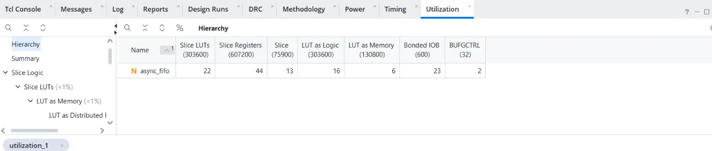
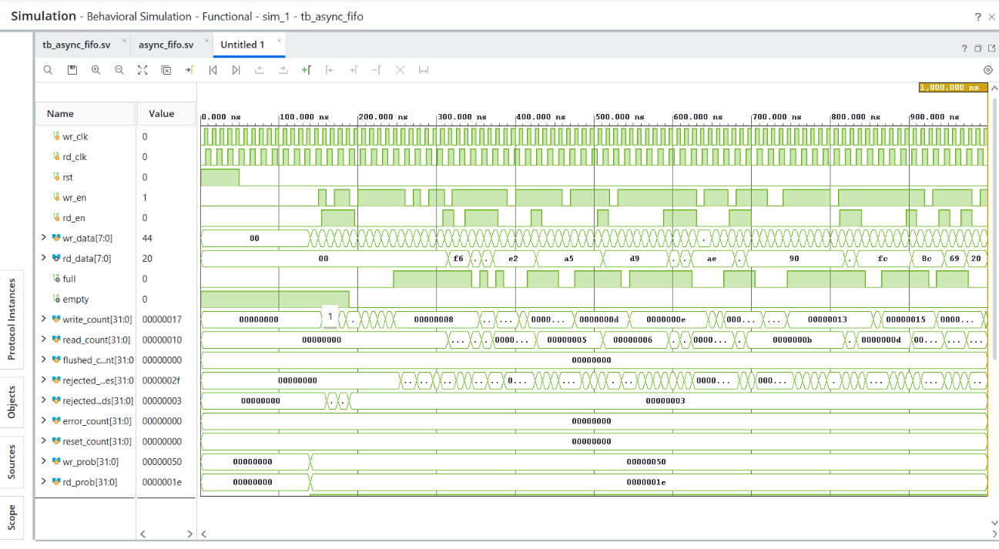
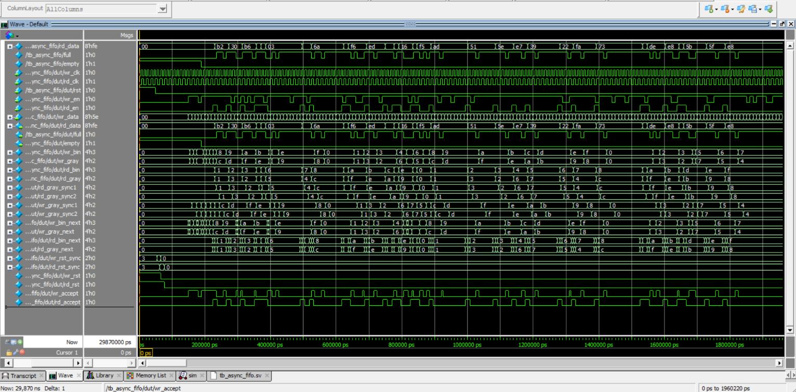

# Asynchronous FIFO (Verilog / SystemVerilog)

A parameterized dual-clock FIFO with gray-code pointers, two-flop synchronizers and per-domain reset synchronizers, verified with a self-checking random + directed testbench in Vivado XSim.

Started from a simple FIFO shown in a course (EDA Playground) and extended into a clock-domain-crossing-safe design.

## Files

| File | Description |
|---|---|
| `async_fifo.sv` | FIFO RTL |
| `tb_async_fifo.sv` | Self-checking testbench with scoreboard |

## Parameters and ports

| Parameter | Default | Meaning |
|---|---|---|
| `DATA_WIDTH` | 8 | Width of a data word |
| `ADDR_WIDTH` | 3 | Depth = 2^ADDR_WIDTH (8 words). Must be >= 2 |

| Port | Dir | Description |
|---|---|---|
| `wr_clk`, `rd_clk` | in | Independent write and read clocks |
| `rst` | in | Active-high asynchronous reset (synchronized internally per domain) |
| `wr_en`, `wr_data` | in | Write request and data (accepted only when not full) |
| `rd_en` | in | Read request (accepted only when not empty) |
| `rd_data` | out | Registered read data, valid one `rd_clk` cycle after an accepted read |
| `full` | out | Registered, write-clock domain |
| `empty` | out | Registered, read-clock domain |

## Design

- **Pointers:** (ADDR_WIDTH + 1)-bit binary pointers; the extra bit distinguishes full from empty.
- **Gray code crossing:** each pointer is converted to gray code (only one bit changes per increment) before crossing, so a sample taken mid-transition is either the old or the new value, never a garbage one.
- **Two-flop synchronizers:** read pointer into the write domain, write pointer into the read domain.
- **Full** (write domain): next write gray pointer equals the synchronized read gray pointer with its top two bits inverted.
- **Empty** (read domain): next read gray pointer equals the synchronized write gray pointer.
- **Pessimistic flags:** because the synchronized pointers lag by about two clocks, `full` and `empty` can clear a few cycles late. This never causes overflow or underflow; it only costs a little throughput.
- **Reset:** `rst` asserts both domains immediately and releases each one synchronously to its own clock (two-flop reset synchronizer per domain). Memory has no reset so FPGA tools can infer RAM.

## Verification

Simulated in Questa and Vivado XSim (`tb_async_fifo` as simulation top). Use `run all` in the Tcl console, or set `xsim.simulate.runtime` to `-all` in Simulation settings, since the default runtime is only 1 us.

The testbench keeps a queue of every accepted write and compares each accepted read against it. It runs:

1. Write-heavy random traffic
2. Read-heavy random traffic
3. Balanced random traffic
4. Both sides saturated
5. Directed: drain to empty, reads while empty rejected, fill to full, writes while full rejected, occupancy checks
6. Resets: while full with traffic toggling, mid-traffic, and a one-cycle pulse; flags and `rd_data` checked and traffic resumed after each
7. Final drain and summary

The test passes only if there are zero errors, the scoreboard is empty at the end, accepted writes equal accepted reads plus entries flushed by resets, and both full and empty were actually hit.

Clock periods are set by `WR_HALF` and `RD_HALF` (default 10 ns and 14 ns); other ratios can be tried by changing them. `VERBOSE = 0` gives a quieter log.

### Results

Final summary from the Vivado XSim run (`run all`, default clocks of 10 ns and 14 ns, finished at 29870 ns):

```
====================================
 ASYNC FIFO VERIFICATION SUMMARY
====================================
Accepted writes  : 1028
Accepted reads   : 1007
Flushed by reset : 21
Resets applied   : 3
Rejected writes  : 740  (full hit)
Rejected reads   : 235  (empty hit)
Remaining entries: 0
Errors           : 0

*** ALL TESTS PASSED ***
```

Accepted writes (1028) equal accepted reads (1007) plus entries flushed by resets (21). Questa gives the same pass with slightly different counts because the two simulators seed the random stimulus differently.

### Synthesis (Vivado, resource estimate only)

Default settings, no constraints, `async_fifo` as top (DATA_WIDTH = 8, ADDR_WIDTH = 3):

| Resource | Used |
|---|---|
| Slice LUTs | 22 (16 as logic, 6 as distributed RAM) |
| Slice registers | 44 |
| Slices | 13 |
| Bonded IOB | 23 |
| BUFGCTRL | 2 |

The 8 x 8 memory was inferred as distributed RAM. Timing and power numbers are not reported because no clock or I/O constraints were applied, so they would not be meaningful.

## Known limitations

- Functionally verified in simulation (Questa and Vivado XSim). It was synthesized and implemented in Vivado for resource estimation only, with no timing constraints, and has not been tested on hardware. Behavioral simulation has no real timing, so it cannot demonstrate metastability behavior. CDC safety rests on the gray-code and two-flop structure.
- Depth must be a power of two, and `ADDR_WIDTH >= 2`.
- `rd_data` has one cycle of read latency (registered output).
- Do not drive `wr_en` / `rd_en` during reset, and wait a few clocks after release before starting traffic.
- No `almost_full` / `almost_empty` flags and no assertions (SVA) yet; both are possible future work.


### Resource Utilization Screenshot


## Simulation Waveforms

### Vivado XSim Waveform


### Questa Waveform


